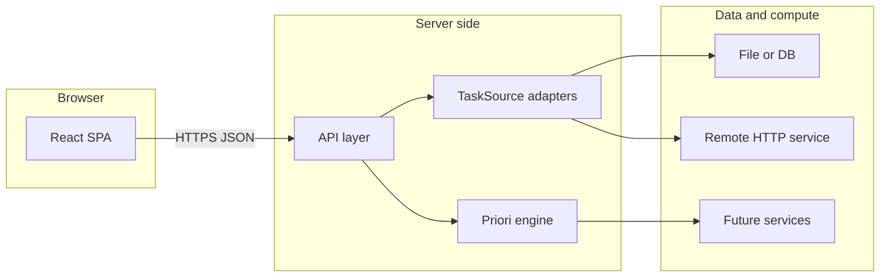

# Frontend and Backend — Technical Design (Boundary)

## 1. Purpose

This document describes the **basic interaction** between the Priori user interface (browser) and server-side capabilities. It defines a **stable boundary** so the React app does not need to know whether tasks are loaded from a local file, a remote HTTP service, or a live channel such as WebSockets.

The **current** backend is centered on the **Priori engine** (ranking and related domain logic). **Later**, the same boundary can host additional services behind a small **API layer**, evolving toward a simple microservices-style deployment without rewriting the frontend contract.

Related documents:
- [Priori Engine — MVP Technical Design](PRIORI_ENGINE_MVP_TECHNICAL_DESIGN.md) — engine behavior and data model
- [Post-Engine Next Steps](POST_ENGINE_NEXT_STEPS.md) — product flows that consume recommendations

## 2. Design Goals

- **Stable API contract:** The browser talks only to **HTTP (and optionally WebSocket or SSE) endpoints** with versioned JSON payloads. It does not embed assumptions about where tasks live or how they are synchronized.
- **Thin UI:** Presentation and interaction live in the frontend; orchestration, authorization, and integration with data sources live **behind** the API.
- **Engine as library:** The ranking pipeline is invoked **in process** as TypeScript modules (normalize → rank → format). The API does not spawn the CLI per request.
- **Pluggable data access:** A **task source** abstraction on the server hides today’s implementation (e.g. file path, env-configured store) from tomorrow’s (remote service, message bus, cache).
- **Evolvable topology:** A single Node process in development can split into **API gateway + engine service + other services** later; the URL paths and payload shapes exposed to the browser should change only when intentionally versioned.

## 3. Repository layout (separate projects)

The repo uses a **strict split** so each directory is one kind of project, with explicit dependencies between them (npm workspaces recommended at the root).

**Intended structure:**

```
priori/
  package.json                 # workspaces: ["packages/*", "apps/*"]; shared dev scripts
  packages/
    engine/                    # Priori engine: ranking domain + CLI only
      package.json
      src/
      test/
  apps/
    api/                         # HTTP API only: routes, validation, TaskSource
      package.json
      src/
    web/                         # Browser UI only: React + Vite
      package.json
      src/
  documentation/
```

| Location | Contains | Must not contain |
|----------|----------|------------------|
| `packages/engine` | Normalizer, ranker, types, task loading, CLI entry | React components, Vite config, HTTP server |
| `apps/api` | Server bootstrap, `/api` routes, env, wiring to engine | UI, bundler frontend config |
| `apps/web` | React app, Vite, styles, calls to `/api` | Direct imports from engine source (avoid coupling UI to domain) |

**Dependency direction:** `apps/api` → `packages/engine` (workspace dependency). `apps/web` → HTTP only to `apps/api` (no engine import).

**Engine code** lives in **`packages/engine`**. New work for the local explorer goes under **`apps/web`** and **`apps/api`** so separation stays clear.

## 4. Logical Architecture



**Responsibilities:**

| Layer | Responsibility |
|-------|----------------|
| **React SPA** | Renders UI; calls documented endpoints; handles loading and error states. |
| **API layer** | Routing, validation, auth (when needed), request/response mapping, correlation IDs. |
| **TaskSource** | Fetches or receives task payloads; may call filesystem, DB, or another HTTP service. |
| **Priori engine** | Deterministic ranking and explainability; pure domain logic given normalized tasks and runtime parameters. |

The API layer is the **only** surface the browser depends on. Internally, it may call the engine directly (monolith) or forward to an **engine microservice** (same JSON contract server-to-server).

## 5. Process and Deployment Models

### 5.1 Development

Typical setup:

- **Frontend:** Vite dev server (e.g. port 5173) serving the React app.
- **Backend:** Small HTTP server (e.g. port 3000) hosting the API and linking TaskSource + engine.

Use a **dev proxy** so the browser calls same-origin paths such as `/api/...` and avoids CORS friction. This is still **two OS processes**; it mirrors how production often separates static assets from API.

### 5.2 Production (flexible)

Options that preserve the same **browser contract**:

- **Single container or process:** One Node app serves the built SPA and mounts API routes (simple operations).
- **Split:** Static site (CDN) + API host; CORS or shared domain configured explicitly.
- **Microservices:** Browser → **API gateway** (or BFF) → engine service, task service, auth service. The gateway aggregates and exposes **one** external API to the SPA.

The frontend should not change when moving from monolith to gateway + services, as long as **paths and JSON schemas** stay compatible or are versioned (`/api/v1/...`).

## 6. API Contract Principles

These principles apply before concrete routes are frozen:

1. **JSON over HTTPS** for commands and queries (e.g. list tasks, run ranking with runtime parameters).
2. **Shared types** aligned with engine concepts (`RawTask`, `RuntimeParams`, ranked results with optional explain payloads). Duplication between server and client should be minimized (shared package or generated OpenAPI client later).
3. **Idempotent reads** where possible; explicit mutations for task changes when the product adds them.
4. **Errors:** Structured error bodies (code, message, optional details) instead of relying on HTML error pages.
5. **Real-time updates (optional, later):** WebSockets or SSE can notify the UI when task data changes; message payloads should reuse the same domain shapes as REST where practical so the React app does not maintain two mental models.

Concrete path names and request bodies will live alongside implementation; this document only fixes **architectural intent**.

## 7. Evolution: From One Engine to Multiple Services

**Today (conceptual):** One backend deployment implements TaskSource + engine ranking in one codebase.

**Later (simple microservices):**

- **Engine service:** Exposes an internal API: given normalized input + runtime params, return ranked results. Stateless, horizontally scalable if needed.
- **Task / sync service:** Owns persistence, external integrations, and eventual consistency; the API layer or gateway composes “get tasks” + “rank” for the UI.
- **Gateway or BFF:** Single entry for the browser; may aggregate calls, handle auth, and translate to internal RPC or HTTP between services.

**What must stay stable:** The **browser-facing** API and DTOs (or explicit versioning when they change). **What may change:** Internal topology, number of processes, and protocols between services (HTTP, gRPC, message queues).

## 8. Security Notes (placeholder)

When the API is reachable beyond localhost:

- Authenticate and authorize users before exposing tasks or ranking for user-specific data.
- Do not expose raw filesystem paths or internal service URLs to the client.
- Rate-limit and validate payload size on ranking endpoints to avoid abuse.

## 9. Non-Goals (for this boundary document)

- Exact REST path list and OpenAPI spec (defined when the HTTP server is implemented).
- Choice of web framework (Express, Fastify, Hono, etc.).
- Microservice discovery, service mesh, or orchestration product choices.

## 10. Revision History

| Date | Change |
|------|--------|
| 2026-04-18 | Initial document: boundary between React client and Priori engine–centric backend; evolution toward simple microservices. |
| 2026-04-18 | Section 3: repository layout (`packages/engine`, `apps/api`, `apps/web`) and dependency rules. |
| 2026-04-18 | Engine sources moved to `packages/engine`; root is npm workspace `priori`. |
